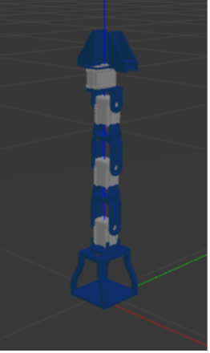
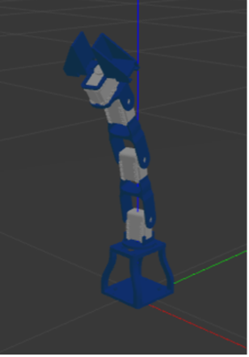
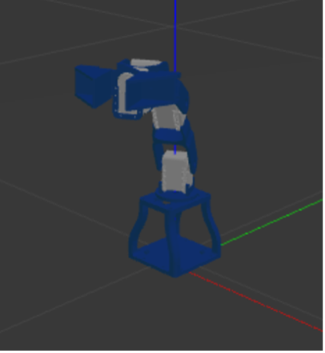
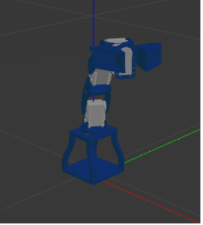
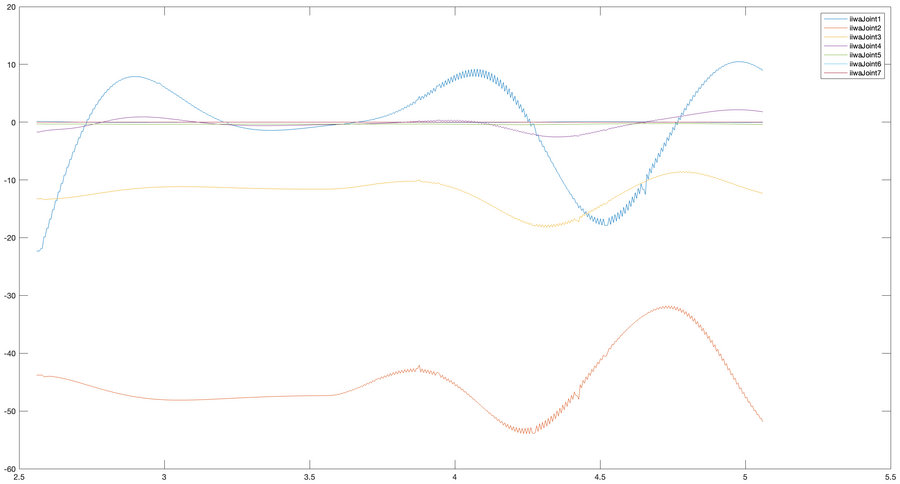
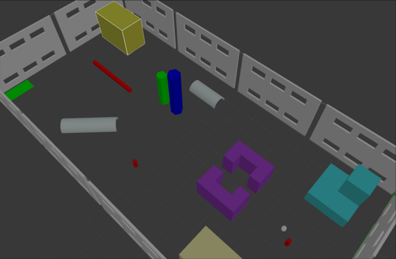
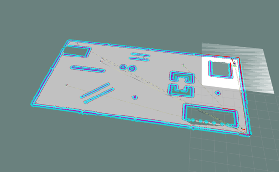
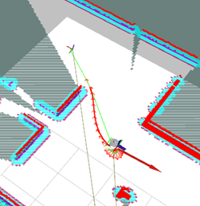

# Robotics Lab: manipulators and mobile robots in ROS

Four homeworks on ROS Noetic and Gazebo, from the model of a robot arm to vision-based control of a 7-DoF manipulator
and autonomous navigation of a mobile robot.

**Robotics Lab** course (Prof. Mario Selvaggio), M.Sc. in Automation Engineering and Robotics, University of Naples
Federico II, academic year 2023/24. Author: **Gaetano Torella**. The homeworks extend starter packages provided by the
course, such as `kdl_robot`, `rl_fra2mo_description` and `rl_racefield`.

<div align="center">

| Homework | Robot | Topics |
|:---|:---|:---|
| [1. Arm description and control](#1-arm-description-and-control) | 4-DoF arm | URDF/xacro, Gazebo, RViz, position controllers, ROS nodes |
| [2. Trajectory planning and control](#2-trajectory-planning-and-control) | KUKA iiwa 14 | Trajectories in Cartesian space, inverse dynamics, KDL |
| [3. Vision-based control](#3-vision-based-control) | KUKA iiwa 14 | OpenCV, ArUco, visual servoing, null-space control |
| [4. Autonomous navigation](#4-autonomous-navigation) | Differential drive robot (fra2mo) | SLAM, move_base, TEB local planner, ArUco |

</div>

## 1. Arm description and control

[`hw1_arm_description/`](hw1_arm_description): the URDF/xacro model of a 4-DoF arm with a camera, its simulation in
Gazebo and RViz, and a position controller for each joint. A ROS node reads the joint states and publishes the position
commands.

<p align="center">
  
  
  
  
</p>

```bash
roslaunch arm_gazebo arm_gazebo.launch          # Gazebo and the controllers
rosrun arm_controller arm_controller_node       # sends the joint commands
roslaunch arm_description display.launch        # or: the model alone in RViz
```

## 2. Trajectory planning and control

[`hw2_trajectory_control/`](hw2_trajectory_control): the end-effector of the iiwa follows linear and circular paths,
with a trapezoidal velocity profile or a cubic polynomial as time law. The trajectories are tracked with an inverse
dynamics controller, in joint space or in operational space, written with KDL. The commanded torques are logged in a
ROS bag and plotted in MATLAB with [`torque_plot/plotting.m`](hw2_trajectory_control/torque_plot/plotting.m).

<p align="center"></p>

Circular path with a cubic polynomial:

<!-- video: hw2_circular_cubic.mp4 -->

Linear path with a trapezoidal velocity profile:

<!-- video: hw2_linear_trapezoidal.mp4 -->

```bash
roslaunch iiwa_gazebo iiwa_gazebo_effort.launch
rosrun kdl_ros_control kdl_robot_test $(rospack find iiwa_description)/urdf/iiwa14.urdf
```

The path, the time law and the controller are selected by commenting lines in `kdl_robot_test.cpp` and
`kdl_planner.cpp`, and rebuilding.

## 3. Vision-based control

[`hw3_visual_servoing/`](hw3_visual_servoing): a camera mounted on the iiwa guides the robot.

- **Perception.** `opencv_ros` detects a circular object with OpenCV's blob detector; `aruco_ros` gives the pose of an
  ArUco marker.
- **Fixed relative pose (2.A).** The camera keeps a fixed pose with respect to the marker, with resolved velocity
  control and a joint target in the null space.
- **Look at the marker (2.B).** The task is the unit vector from the camera to the marker, which evolves on the sphere
  S², controlled through its interaction matrix; the null space remains free for the redundancy.
- **Vision and dynamics (2.C).** The inverse dynamics controller of homework 2 follows a circular trajectory while the
  camera looks at the marker.

In the videos: the camera image with the detected marker on the left, Gazebo on the right.

Fixed relative pose, moving the marker:

<!-- video: hw3_point_2A.mp4 -->

Look at the marker, moving the marker:

<!-- video: hw3_point_2B.mp4 -->

Circular trajectory while looking at the marker:

<!-- video: hw3_point_2C.mp4 -->

```bash
export URDF=$(rospack find iiwa_description)/urdf/iiwa14.urdf

# circular object
roslaunch iiwa_gazebo iiwa_gazebo_circular_object.launch
rosrun opencv_ros opencv_ros_node

# ArUco marker, velocity control (2.A and 2.B)
roslaunch iiwa_gazebo iiwa_gazebo_aruco.launch
roslaunch opencv_ros usb_cam_aruco.launch camera:=iiwa/camera1
rosrun kdl_ros_control kdl_robot_vision_control $URDF

# ArUco marker, inverse dynamics (2.C)
roslaunch iiwa_gazebo iiwa_gazebo_aruco_dynamic.launch
roslaunch opencv_ros usb_cam_aruco.launch camera:=iiwa/camera1
rosrun kdl_ros_control kdl_robot_vision_control_dynamic $URDF
```

Tasks 2.A and 2.B are selected by commenting lines in `kdl_robot_vision_control.cpp`, and rebuilding.

## 4. Autonomous navigation

[`hw4_navigation/`](hw4_navigation): the fra2mo robot builds a map with gmapping and moves with move_base and the TEB
local planner. It visits goals published as static TF frames, then uses its camera to find an ArUco marker and computes
a new goal relative to it. The effect of the planner parameters (clearance, footprint, velocity limits) was also tested.

<p align="center">
  
  
  
</p>

In the video: Gazebo on the left; on the right the onboard camera, which detects marker 115 towards the end, and the map
in RViz.

<!-- video: hw4_navigation.mp4 -->

```bash
roslaunch fra2mo_2dnav fra2mo_nav_bringup.launch    # Gazebo, gmapping and move_base
roslaunch fra2mo_2dnav usb_cam_aruco.launch         # ArUco detection
rosrun fra2mo_2dnav tf_nav                          # asks which goal to send: TF goals, home or marker
```

## Building

Developed on Ubuntu 20.04 with ROS Noetic and `catkin_tools`. Each homework folder is linked into the workspace on its
own, because homeworks 2 and 3 both contain a package called `kdl_ros_control`.

```bash
git clone https://github.com/gaetanotorella/robotics-lab-ros.git ~/robotics-lab-ros

cd ~/catkin_ws/src
ln -s ~/robotics-lab-ros/hw3_visual_servoing .      # the homework you want
ln -s ~/robotics-lab-ros/third_party/iiwa_stack .   # only for homeworks 2 and 3

cd ~/catkin_ws
sudo apt install ros-noetic-aruco-ros               # only for homeworks 3 and 4
rosdep install --from-paths src --ignore-src -y
catkin build && source devel/setup.bash
```

To change homework, replace the link and run `catkin clean -y` before building again.

## Third-party code

[`third_party/iiwa_stack`](third_party) is a modified copy of [IFL-CAMP/iiwa_stack](https://github.com/IFL-CAMP/iiwa_stack)
(BSD 2-Clause); [`third_party/README.md`](third_party/README.md) lists what changes from the original.
